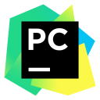
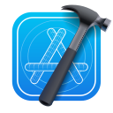

# Shu

Software Development / Computer Vision / Robotics / Tech Community

## Tech Stack

<table width="100%">
  <tr>
    <td valign="top" width="430">
      <strong>Languages</strong>  
      

        
        
        
        
        
        
      

    </td>
    <td valign="top" width="430">
      <strong>Infrastructure</strong>  
      

        
        
        
        
      

    </td>
  </tr>
</table>

<table width="100%">
  <tr>
    <td valign="top" width="860">
      <strong>Developer Tools</strong>  
      

        
        
        
        
        
        
        
        
        
        
      

    </td>
  </tr>
</table>
